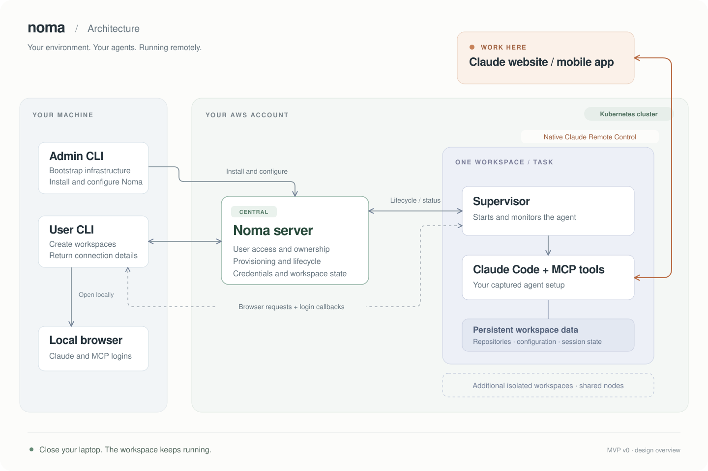

# noma

Run your existing coding agents in isolated, reproducible remote development environments. Bring your own harness, configuration, and infrastructure.

## Architecture

Noma prepares and manages remote workspaces. You work with the agent through its own interface.

The initial design targets Claude Code on Kubernetes in your AWS account:

- **Admin CLI** bootstraps AWS infrastructure and installs and configures Noma.
- **User CLI** captures your local agent setup, creates workspaces, and returns connection details. It also opens remote login requests in your local browser.
- **Noma server** runs centrally and manages workspace access, provisioning, and lifecycle.
- **Workspace supervisor** runs alongside the agent, starts and monitors it, and relays browser requests. Each workspace has its own repositories and persistent data.

Once a workspace is ready, connect through Claude's native Remote Control. The agent and its tools keep running remotely when your laptop disconnects.
