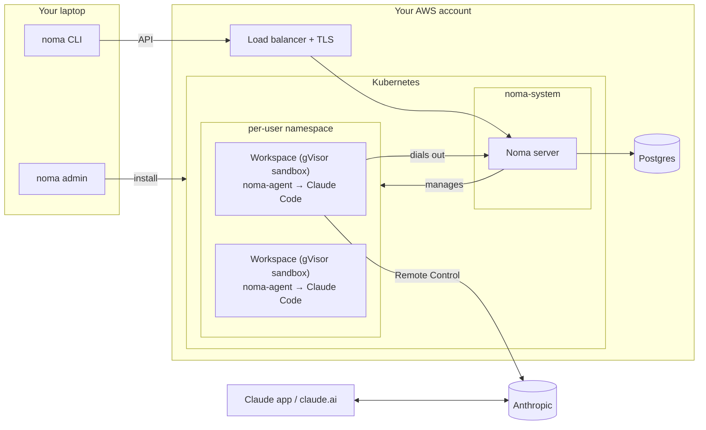

# noma

Run your existing coding agents in isolated, reproducible remote development environments. Bring your own harness, configuration, and infrastructure.

## Architecture

Noma prepares and manages remote workspaces. You work with the agent through its own interface.

The initial design targets Claude Code on Kubernetes (EKS) in your AWS account:

- **Admin CLI** provisions AWS infrastructure and installs Noma: cluster, node pools, storage, Postgres, and the policies that constrain every workspace.
- **User CLI** creates and manages workspaces, captures your local agent setup, and relays login requests to your local browser.
- **Noma server** stores users and workspaces in Postgres and reconciles them into Kubernetes resources. It runs with narrow permissions, and admission policies limit what it can create.
- **Workspaces** run one per pod in a gVisor sandbox, each with its own volume, its own Claude login and no inbound network access. The **noma-agent** inside starts and supervises Claude Code and connects out to the server.

Once a workspace is ready, connect through Claude's native Remote Control. The agent and its tools keep running remotely when your laptop disconnects.
