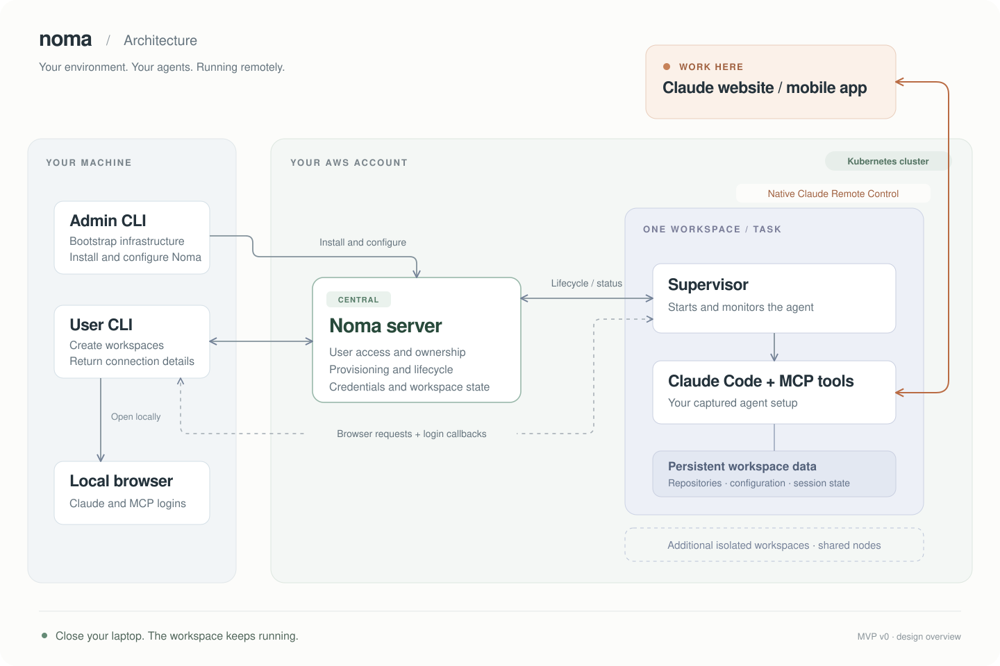

# noma

Run your existing coding agents in isolated, reproducible remote development environments. Bring your own harness, configuration, and infrastructure.

## Architecture

Noma prepares and manages remote workspaces. You work with the agent through its own interface.

The initial design targets Claude Code on Kubernetes in your AWS account:



- **Admin CLI** bootstraps AWS infrastructure and installs and configures Noma.
- **User CLI** captures your local agent setup, creates workspaces, and returns connection details. It also opens remote login requests in your local browser.
- **Noma server** runs centrally and manages workspace access, provisioning, and lifecycle.
- **Workspace supervisor** runs alongside the agent, starts and monitors it, and relays browser requests. Each workspace has its own repositories and persistent data.

Once a workspace is ready, connect through Claude's native Remote Control. The agent and its tools keep running remotely when your laptop disconnects.

## Try it locally

You need Docker, [minikube](https://minikube.sigs.k8s.io), kubectl, Go 1.26 and a Claude Pro, Max, Team or Enterprise plan.

```bash
make dev-up    # local cluster with gVisor, Postgres and noma-server, and bin/noma
bin/noma up https://github.com/MrDHat/noma.git
```

`noma up` creates the workspace, asks you to sign in to Claude in your browser and paste the code, and prints a `claude.ai/code` link. Open it on your phone or in the browser to work with Claude on Noma itself. `bin/noma rm noma` deletes the workspace, and `make dev-down` deletes the cluster. After pulling new code, `make deploy` rebuilds everything, `bin/noma` included; stop and start a workspace to move it onto the new agent.

For development, `make e2e` runs the end-to-end tests against a cluster started with `NOMA_CLAUDE=fake make dev-up`, and `make demo-real` walks through the full demo with real Claude.

## License

Noma is source-available under the [Elastic License 2.0](LICENSE). You can use, modify, and self-host it for your own use. You may not offer it to others as a hosted or managed service.
