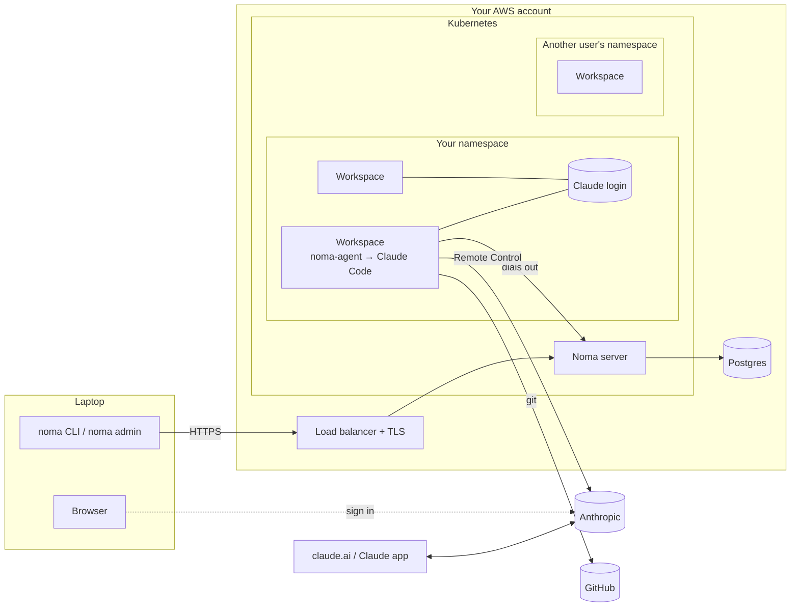
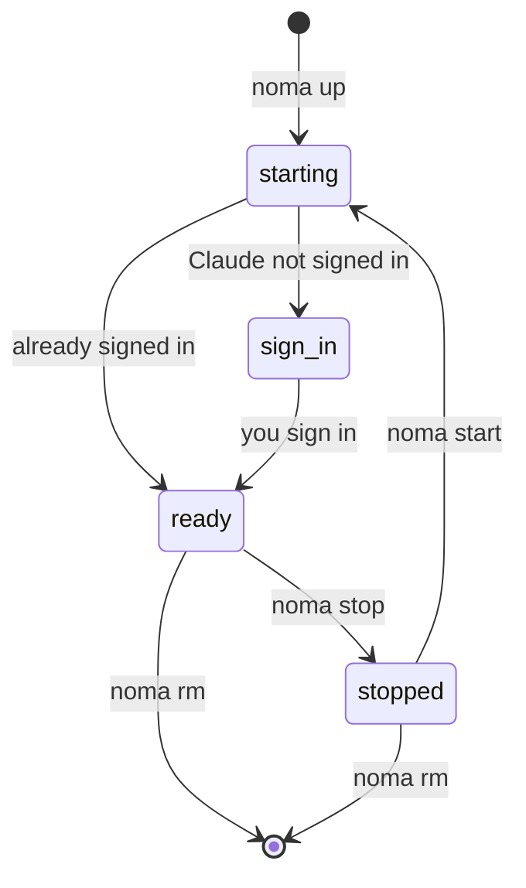

# Cloud architecture

## What runs where

- **`noma admin`** runs on an admin's laptop. It sets up the AWS resources (EKS cluster, Postgres, load balancer) and installs Noma into the cluster.
- **`noma`** is the CLI you use to create, start, stop and delete workspaces. It talks only to the Noma server.
- **Noma server** runs in the cluster behind the load balancer. It stores users and workspaces in Postgres and creates the matching Kubernetes resources. Two copies run for availability.
- **Workspaces** run one per pod, in your own namespace. Each one has its own disk. Inside, **noma-agent** clones your repos, applies your captured setup, starts Claude Code and keeps it running.

## How workspaces are isolated

- Every workspace runs in a [gVisor](https://gvisor.dev) sandbox, so code in a workspace doesn't talk to the node's kernel directly.
- Each user gets their own Kubernetes namespace, and each workspace gets its own disk. Workspaces don't share files, apart from your Claude login (see below).
- Workspaces accept no inbound connections. They can reach the internet, but not the Kubernetes API, cloud metadata, the database or other workspaces.
- Workspaces carry no Kubernetes or cloud credentials. The Noma server runs with narrow permissions, and cluster admission rules, which the server can't change, reject any workspace that doesn't meet these rules.

## Claude login

You sign in to Claude once, and all your workspaces use that login.

- Your login is kept on a small volume that only your workspaces mount. Each workspace still has its own Claude settings, history and sessions.
- Sign-in uses Anthropic's own page in your browser. The CLI passes the code to your workspace end-to-end encrypted, so the Noma server never sees it.
- Only Claude Code reads or writes your login. Noma never reads, copies or stores it.
- Signing out signs out all your workspaces. Admins can switch to one login per workspace instead.

## Workspace lifecycle

- **Stop** shuts the workspace down and keeps its disk. **Start** brings it back with the same files and the same Remote Control link.
- If a node goes away, the workspace restarts on another node with the same disk.
- **Remove** deletes the workspace and its disk.

Once a workspace is ready, the CLI prints a `claude.ai/code` link. Open it from the Claude app or claude.ai to work with the agent.

## Running locally

The same setup runs on minikube for development, with an in-cluster Postgres and port-forwarding instead of a load balancer.
